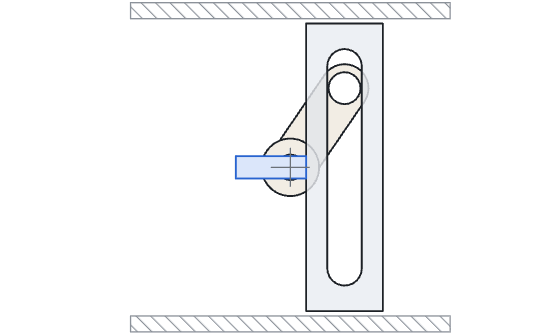
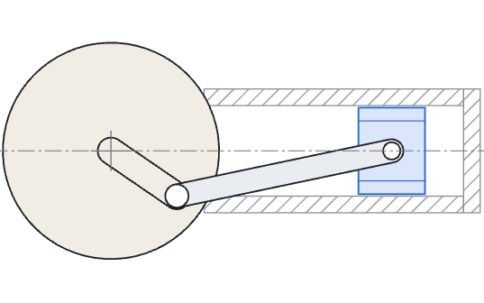
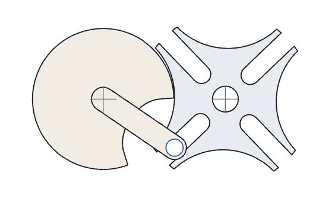
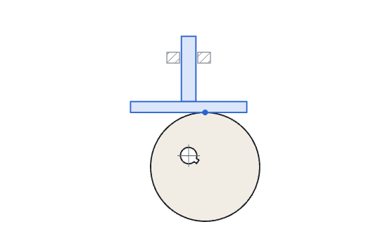
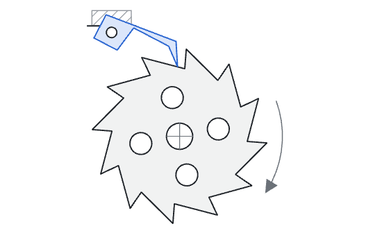
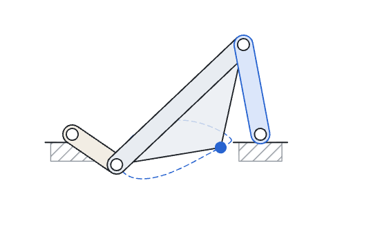
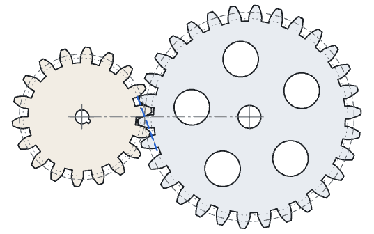
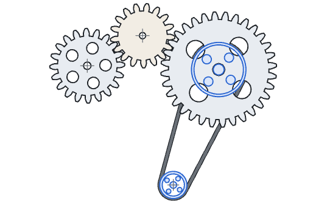

# mechanism-lab

Textbook mechanisms and involute gears as a small JavaScript library with no
dependencies, plus a static demo page that animates each one as SVG. Every
mechanism is checked numerically against its own kinematics: in Node with
`node --test`, and in the browser when the demo page loads.

Built with AI coding agents; every mechanism is checked numerically against its kinematics.

## Mechanisms

| | |
| --- | --- |
|  | **Scotch yoke.** A crank pin running in a straight slot drives the yoke as x = r sin θ. Checked: the pin stays on its crank circle and on the slot centreline, never reaches the slot ends, the yoke stays on its guide, the stroke is 2r, and the output is a pure sinusoid (harmonics 2 to 8 below 1e-9 of the fundamental). |
|  | **Crank and slider.** The connecting rod is solved exactly, not with the small-angle approximation. Checked: the rod length is constant, the slider stays on its axis, the dead centres sit at L + r and L - r, and the measured second harmonic matches the series L(λ²/4 + λ⁴/16 + 15λ⁶/512) for λ = r/L. |
|  | **Geneva drive (4 slots).** The centre distance is forced by the slot count, c = a / sin(π/n). Checked: the pin enters and leaves the slot tangentially, stays on the slot centreline while driving, the star indexes exactly 2π/n per turn, the dwell is motionless, the handoff is continuous with zero star velocity, the pin and locking disc never cut into the star, and during the dwell the star cannot be turned 2° either way without hitting the driver. |
|  | **Eccentric cam and flat-faced follower.** Checked: the follower face is tangent to the cam (centre-to-face distance equals R), the drawn cam outline touches the face without penetrating it, the total lift is 2e, the motion is simple harmonic, and the contact point stays on the face. |
|  | **Ratchet and pawl.** The pawl tip is solved onto the tooth it is riding by intersecting its circle about the pivot with the tooth slope. Checked: the tip lies on the wheel outline at every angle, the pawl body never penetrates the wheel, there are exactly n clicks per revolution, turning the wheel back from any tooth runs the face into the tip while turning it forward does not, and a reverse load pulls the pawl into the tooth. |
|  | **Four-bar linkage (crank-rocker).** Solved by circle intersection on a fixed branch. Checked: Grashof's condition with the crank as the shortest link, closure at every crank angle, constant link lengths, no branch flip, rocker extremes equal to the toggle-position prediction, transmission-angle extremes equal to the law-of-cosines prediction, and a transmission angle between 40° and 140°. |
|  | **Involute spur gear pair.** 18 and 30 teeth, module 4, 20° pressure angle, a little backlash. Checked on the outlines themselves: flank normals are tangent to the base circle, the pressure angle at the pitch circle is 20°, the tooth count read off the outline is N, the centre distance is m(N1 + N2)/2, the speed ratio is -N1/N2, the teeth never interfere over a tooth cycle, the backlash is split evenly (tooth centred in the gap), and with one flank closed, contact is held through the whole tooth cycle (conjugate action). |
|  | **Idler train and open belt.** Checked: every mesh in the train meets the gear-pair conditions, the output ratio depends only on the end gears (measured again with three different idlers), the belt tangent points lie on both rims and the runs are perpendicular to both radii, the belt length matches the closed-form open-belt length, and the pulleys turn the same way at equal surface speed. |

## How verification works

Each mechanism is a model with a `pose()` function: given the input angle, it
returns where every moving part is. The demo draws whatever `pose()` returns.
The checks in `src/checks/` test the same output.

A check states a property of the mechanism and then measures the pose against
it. It does not re-run the formula the model used, because a check written by
restating the implementation agrees with the implementation however wrong both
are. Dimensions are read off the model object, not typed into the check. Some
examples:

- **Geneva lock.** The star outline is placed where the pose says the star is,
  turned 2° further each way, and tested for overlap against the locking disc
  and pin outlines. If either direction is free at any dwell angle, the check
  fails.
- **Gear conjugate action.** The driven gear is turned until one flank touches,
  then both gears are run through a full tooth cycle with that offset held. The
  gap between the two outlines must stay at zero, neither opening nor biting.
  This is what a constant speed ratio means for real tooth shapes.
- **Ratchet blocking.** The wheel outline is turned back half a degree from
  each engaged position. The tip must end up inside the wheel, on an edge that
  is radial (the tooth face), and the face's contact force must have a moment
  about the pawl pivot that pulls the pawl in.
- **Belt length.** The length is measured from the tangent points and the wrap
  angles found on each pulley, then compared with the textbook closed form.

Every check suite is also run against deliberately broken designs, and each of
those tests names the check that has to fail: a yoke slot cut too short, the
small-angle slider formula, a Geneva star placed 3 % too far away, a locking
disc with no relief, straight-flank gear teeth, a driven gear half a tooth out
of phase, a pawl pivot inside the tangent line, a belt drawn by offsetting the
centre line, and others. A check that has never failed proves nothing.

The full list of criteria, with tolerances, is in [ACCEPTANCE.md](ACCEPTANCE.md).
A test reads that file and fails if any mechanism criterion has no check.

### What the checks changed

- The Geneva locking disc first had the usual circular relief. At 0.2 mm lock
  clearance that leaves the star free to turn about 2.1° just after the pin
  leaves the slot, which fails the 2° lock check. The relief is now generated
  from the star's own swept motion, seen from the turning driver, which keeps
  that free play to about 1.4°. A 3-slot star needs the lock clearance cut to
  0.1 mm to pass.
- The first pawl's underside climbed away from the tip too shallowly and
  dragged through the tooth slopes by up to 1.7 mm. It now has a chisel tip
  whose underside climbs away faster than any slope it rides, and its pivot
  sits further outside the tangent line.
- A 12-tooth pinion meshing with 34 teeth fails the conjugate-action check.
  Below 17 teeth at 20° a cut pinion is undercut, and this model does not cut
  the undercut, so the mating tip works below the base circle where the flank
  is no longer an involute. That case is kept as a test.

## Run it

Tests (Node 18 or newer, no install step):

```sh
node --test
```

Demo page: serve the folder with any static file server and open it. ES
modules do not load from `file://`.

```sh
python3 -m http.server 8000
# then open http://localhost:8000
```

The page animates all eight mechanisms, runs `verify()` on the same model
objects it draws, and shows the result as a badge. Each panel lists its checks
with measured values. `?still` starts paused, as does a system
reduced-motion setting.

The README images come from `tools/capture.mjs`, which drives the demo page in
headless Chrome. It needs `puppeteer-core`, `pngjs` and `gifenc`, which are not
dependencies of the library; see the comment at the top of the file.

## Use it as a library

```js
import { geneva, spurGear, gearPair, verify } from './src/index.js';

const g = geneva({ n: 6, a: 40, pinR: 3 });
g.pose(0.2);              // { theta, star, pin, engaged }

const pair = gearPair(spurGear({ N: 20, m: 2, backlash: 0.08 }), spurGear({ N: 45, m: 2, backlash: 0.08 }));
pair.pose(1.0).phis;      // gear angles for an input angle of 1 rad

const report = verify({ geneva: g, gearPair: pair });
report.pass;              // true
report.results;           // [{ mechanism, id, name, value, op, limit, pass }, ...]
```

| Function | Pose fields |
| --- | --- |
| `scotchYoke({ r, pinR, ... })` | `pin`, `yoke` |
| `crankSlider({ r, L, ... })` | `crankPin`, `slider` |
| `geneva({ n, a, pinR, lockPlay, relief, ... })` | `pin`, `star`, `engaged` |
| `camFollower({ R, e, faceW, ... })` | `camCentre`, `faceY`, `contact` |
| `ratchet({ n, R, Rr, pawlLen, tiltDeg, ... })` | `tip`, `pawl`, `tooth` |
| `fourBar({ ground, crank, coupler, rocker, branch })` | `B`, `C`, `P` (coupler point) |
| `spurGear({ N, m, pressureDeg, backlash })` | outline only |
| `gearTrain(gears, angles)` / `gearPair(g1, g2, angle)` | `phis` |
| `openBelt(c1, r1, c2, r2)` | `phi1`, `phi2`; also `runs` and `path()` |

Units are millimetres and radians. The y axis points down, as in SVG, so a
positive angle turns clockwise on screen.

## Layout

| Path | Contents |
| --- | --- |
| `src/` | The models and plane-geometry helpers. No DOM access. |
| `src/checks/` | The check suites. They import only geometry helpers and the gear builder, never drawing code. |
| `src/verify.js` | `verify()`: runs every suite and returns a report. |
| `demo/` | The demo page's drawing and animation code. |
| `test/` | `node --test` suites, including the broken-design tests. |
| `tools/capture.mjs` | Optional: checks the demo in headless Chrome and renders the images. |
| `ACCEPTANCE.md` | The acceptance criteria, written before the code. |

## License

MIT. See [LICENSE](LICENSE).
